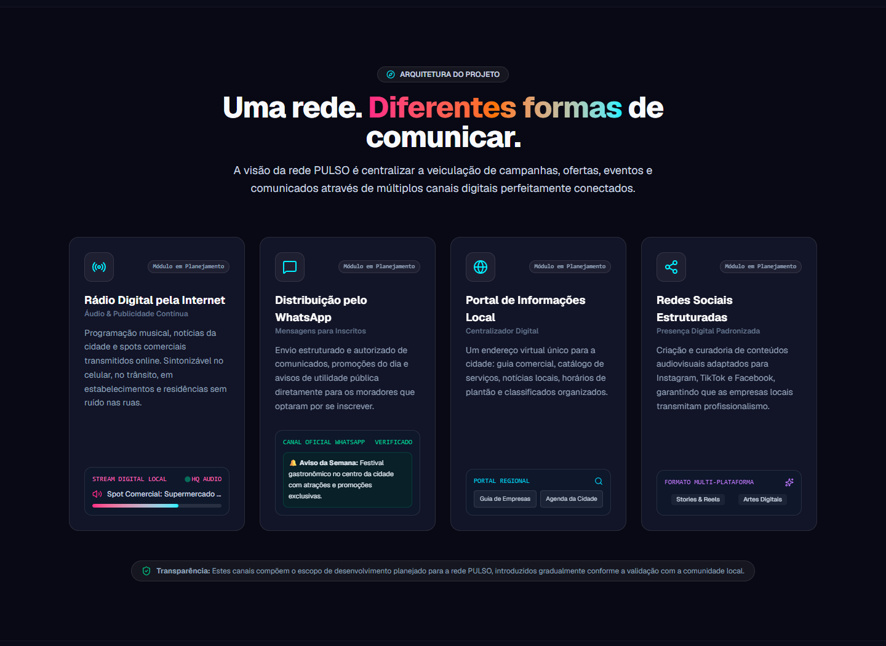

# ⚡ PULSO — Rede de Comunicação Local

> **Uma mensagem. Vários canais. Toda a cidade conectada.**  
> *A sua cidade em uma nova frequência.*  
> Uma infraestrutura digital integrada para modernizar a comunicação comercial e institucional em cidades pequenas e médias do interior.

---

## 📸 Demonstração Visual da Plataforma

<div align="center">
  
  <p><em>Primeira dobra com a proposta de valor e a simulação em tempo real do PULSO HUB (Rádio Web, WhatsApp VIP e Portal da Cidade).</em></p>
</div>

<br />

### 📊 Indicadores Inaugurais & Lançamento Transparente
<div align="center">
  
  <p><em>Transparência total desde o marco zero: abertura para os primeiros municípios e estabelecimentos pioneiros.</em></p>
</div>

<br />

### 📡 A Solução Multicanal
<div align="center">
  
  <p><em>Rádio Digital Web, Transmissão via WhatsApp, Portal Regional e Formatos de Redes Sociais.</em></p>
</div>

<br />

### 🔄 Como Funciona o Fluxo Integrado
<div align="center">
  
  <p><em>Fluxo simplificado da mensagem comercial até a chegada ao smartphone do morador.</em></p>
</div>

<br />

### 👔 Liderança Executiva & Propósito Regional
<div align="center">
  
  <p><em>Compromisso regional com a liderança de Gadiego Nogueira (Conquista – MG), unindo tecnologia de software e processos reais.</em></p>
</div>

<br />

### 📝 Formulário de Interesse Institucional
<div align="center">
  
  <p><em>Validação de interesse, máscara de telefone automática e conformidade com a LGPD.</em></p>
</div>

---

## 📌 Sobre o Projeto

No interior do Brasil, os carros de som e panfletos físicos ainda são os meios mais comuns de divulgação para o comércio local. A **Rede PULSO** nasce como uma proposta contemporânea, inteligente e sustentável para modernizar essa comunicação.

O projeto reúne múltiplos canais em um único ecossistema, permitindo que lojistas e prestadores de serviços alcancem a população com agilidade, sem gerar poluição sonora nas ruas e sem depender exclusivamente de algoritmos imprevisíveis das redes sociais.

> [!IMPORTANT]
> Este repositório contém a **plataforma completa em produção da Rede PULSO**, incluindo Portal Institucional, Guia Comercial Público (`/guia`), Mural Oficial da Cidade (`/mural`), Rádio Digital com Sequenciador Automático (`/api/radio/queue`), Portal do Comerciante Parceiro (`/portal`) e Suíte Administrativa Enterprise (`/admin`) com RBAC em 3 camadas, MFA (TOTP) e Auditoria Imutável no PostgreSQL.

---

## 🏛️ Arquitetura & Módulos da Plataforma

1. **🛡️ Governança, Autenticação & RBAC (`src/lib/auth`, `src/proxy.ts`)**:
   - **Defesa em 3 Camadas**: Proxy de borda Next.js 16 (`src/proxy.ts`), Guardas de Server Components (`requireAdmin`, `requireMerchant`, `requireAuth`) e validação estrita em Server Actions.
   - **Hierarquia de Papéis**: `admin`, `operator`, `merchant` e `user` protegidos por Triggers no PostgreSQL (`protect_profile_privileges`) com imunidade entre administradores e bloqueio de auto-elevação.
   - **Segurança Avançada**: Autenticação Multifator (`TOTP`), revogação remota de sessões, rate-limiting contra força bruta, convites criptográficos SHA-256 (48h) e trilha perene em `audit_logs`.
2. **📻 Rádio Digital & Sequenciador de Áudio (`/admin/radio`, `/api/radio/queue`)**:
   - Upload de spots comerciais e vinhetas no Supabase Storage (`radio-spots`), grade semanal de programação por cidade e player flutuante com sequenciamento inteligente e transição contínua.
3. **🏪 Comércios, Guia Local & Portal do Comerciante (`/admin/comercios`, `/guia`, `/portal`)**:
   - Catálogo público com busca instantânea, filtro por segmentos e telemetria real de cliques no WhatsApp (`whatsapp_clicks`).
   - Área exclusiva do comerciante parceiro (`/portal`) para edição da própria vitrine, acompanhamento de métricas e solicitação de novos spots para a rádio.
4. **💬 Central de WhatsApp & Mural da Cidade (`/admin/whatsapp`, `/mural`)**:
   - Formatador padronizado de comunicados de utilidade pública, alertas municipais e informes comerciais, gestão de grupos comunitários por bairro e exibição em tempo real no Mural da Cidade (`/mural`).

---

## 🎨 Identidade Visual Contemporânea & Alta Energia

A identidade visual foi desenvolvida com forte apelo estético contemporâneo, equilibrando modernidade tecnológica, dinamismo urbano e credibilidade institucional para o varejo:

- **Paleta Sunset & Frequência Neon**: *Sunset Pink* (`#ff2a85`), *Tangerine/Amber* (`#ff7300` / `#f59e0b`) e *Electric Cyan* (`#00f0ff` / `#0284c7`).
- **Modo Escuro (Dark Mode)**: Imersão em tons *Midnight Obsidian* (`#080914`), com linhas de grade tecnológicas sutis, efeitos de iluminação e bordas com gradiente luminoso.
- **Modo Claro (Light Mode)**: Fundo limpo, contemporâneo e de alto contraste em ardósia/off-white (`#fcfcfd`), garantindo legibilidade perfeita e sofisticação empresarial.
- **Alternador de Tema**: Botão Sol / Lua no cabeçalho com transição fluida e persistência via `localStorage`.

---

## 🛠️ Tecnologias Utilizadas

- **Framework**: [Next.js](https://nextjs.org/) (App Router & Turbopack)
- **Linguagem**: [TypeScript](https://www.typescriptlang.org/)
- **Biblioteca de UI**: [React](https://react.dev/)
- **Estilização**: [Tailwind CSS v4](https://tailwindcss.com/)
- **Ícones**: [Lucide React](https://lucide.dev/)
- **SEO & Metadados**: Schema.org JSON-LD, Sitemap dinâmico, Robots.txt, OpenGraph e Favicon SVG/PNG nativos.

---

## 🚀 Como Executar Localmente

### Pré-requisitos
- Node.js 18+ instalado
- Gerenciador de pacotes `npm`

### Instalação

1. Clone o repositório ou navegue até a pasta do projeto:
   ```bash
   cd pulso
   ```

2. Instale as dependências:
   ```bash
   npm install
   ```

3. Inicie o servidor de desenvolvimento:
   ```bash
   npm run dev
   ```

4. Abra no navegador:
   ```
   http://localhost:3000
   ```

### Build de Produção

Para testar o build estático otimizado:
```bash
npm run build
npm run start
```

---

## ⚖️ Licença & Termos Institucionais

Desenvolvido para apresentação e validação da marca **PULSO — Rede de Comunicação Local**.  
Liderança e engenharia: [Gadiego Nogueira](https://www.gadiegon.com).  
Todos os direitos reservados © 2026.
