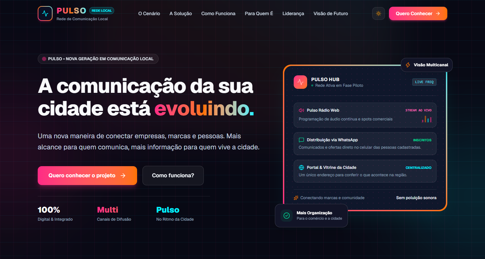
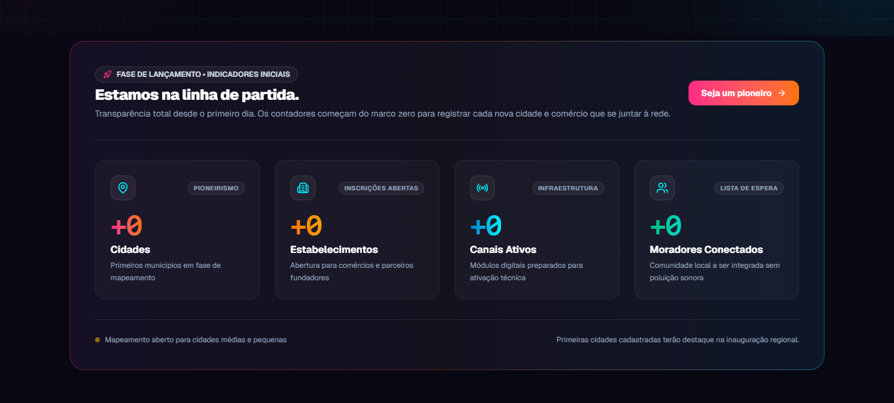
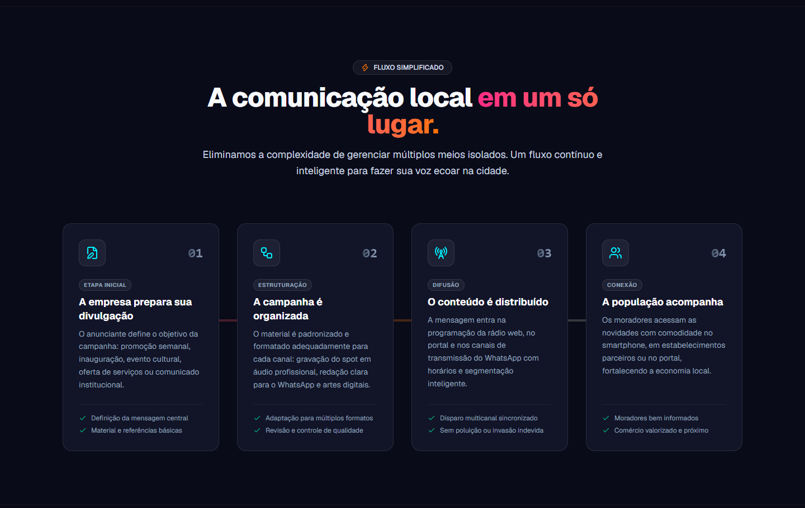
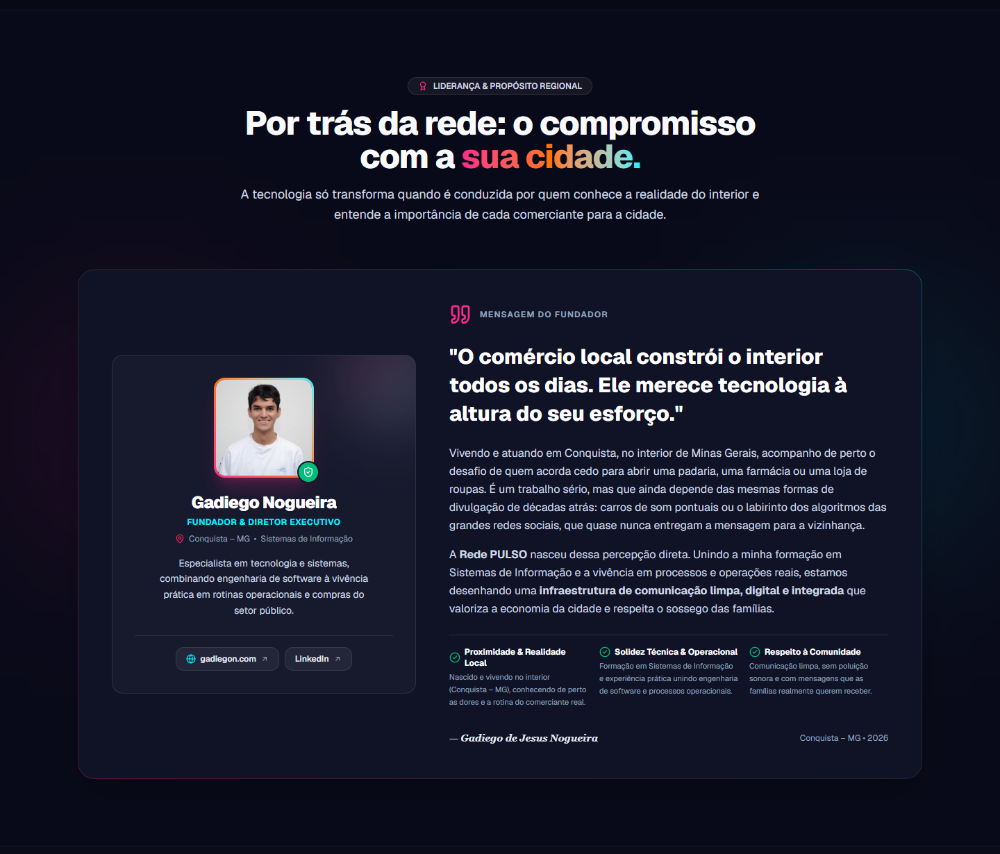
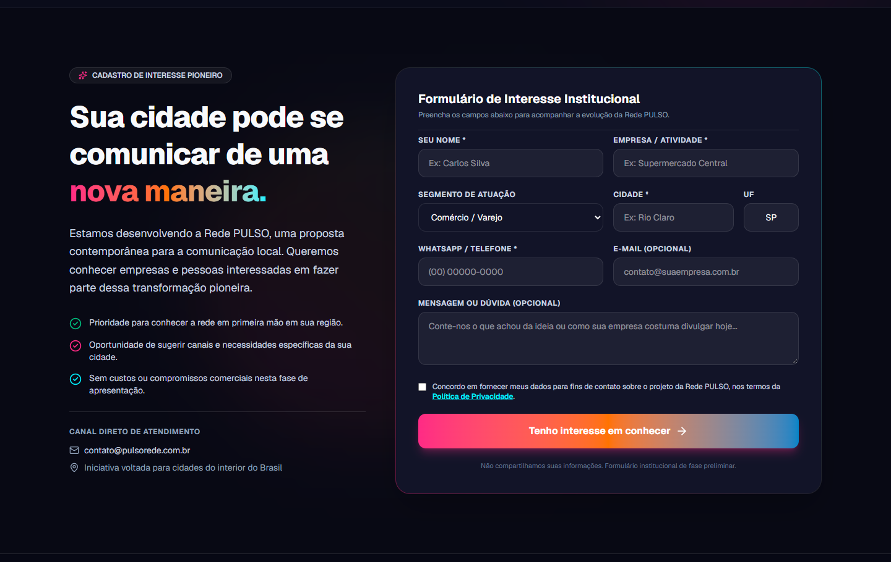

# ⚡ PULSO — Rede de Comunicação Local

> **Uma mensagem. Vários canais. Toda a cidade conectada.**  
> *A sua cidade em uma nova frequência.*  
> Uma infraestrutura digital integrada para modernizar a comunicação comercial e institucional em cidades pequenas e médias do interior.

---

## 📸 Demonstração Visual da Plataforma

<div align="center">
  
  <p><em>Primeira dobra com a proposta de valor e a simulação em tempo real do PULSO HUB (Rádio Web, WhatsApp VIP e Portal da Cidade).</em></p>
</div>

<br />

### 📊 Indicadores Inaugurais & Lançamento Transparente
<div align="center">
  
  <p><em>Transparência total desde o marco zero: abertura para os primeiros municípios e estabelecimentos pioneiros.</em></p>
</div>

<br />

### 📡 A Solução Multicanal
<div align="center">
  
  <p><em>Rádio Digital Web, Transmissão via WhatsApp, Portal Regional e Formatos de Redes Sociais.</em></p>
</div>

<br />

### 🔄 Como Funciona o Fluxo Integrado
<div align="center">
  
  <p><em>Fluxo simplificado da mensagem comercial até a chegada ao smartphone do morador.</em></p>
</div>

<br />

### 👔 Liderança Executiva & Propósito Regional
<div align="center">
  
  <p><em>Compromisso regional com a liderança de Gadiego Nogueira (Conquista – MG), unindo tecnologia de software e processos reais.</em></p>
</div>

<br />

### 📝 Formulário de Interesse Institucional
<div align="center">
  
  <p><em>Validação de interesse, máscara de telefone automática e conformidade com a LGPD.</em></p>
</div>

---

## 📌 Sobre o Projeto

No interior do Brasil, os carros de som e panfletos físicos ainda são os meios mais comuns de divulgação para o comércio local. A **Rede PULSO** nasce como uma proposta contemporânea, inteligente e sustentável para modernizar essa comunicação.

O projeto reúne múltiplos canais em um único ecossistema, permitindo que lojistas e prestadores de serviços alcancem a população com agilidade, sem gerar poluição sonora nas ruas e sem depender exclusivamente de algoritmos imprevisíveis das redes sociais.

> [!NOTE]
> Este repositório contém a **landing page institucional e de apresentação de conceito** do projeto pioneiro. Não inclui plataformas administrativas, backend de anúncios ou sistemas de autenticação, que fazem parte do roadmap futuro.

---

## 📡 Visão Multicanal da Rede

A proposta da PULSO é integrar gradualmente os seguintes canais:

1. **📻 Rádio Digital pela Internet**: Programação musical contínua, notícias locais e veiculação de spots comerciais transmitidos online (ouvida no trânsito, no celular ou nos estabelecimentos).
2. **💬 Distribuição via WhatsApp**: Canal verificado para envio autorizado de ofertas do dia, comunicados e utilidade pública para moradores cadastrados voluntariamente.
3. **🌐 Portal & Vitrine Local**: Um ponto de encontro centralizado na web com guia comercial, agenda de eventos, classificados e notícias da região.
4. **📱 Conteúdos para Redes Sociais**: Materiais audiovisuais padronizados e profissionais para ampliar a presença digital das marcas parceiras.

---

## 🎨 Identidade Visual Contemporânea & Alta Energia

A identidade visual foi desenvolvida com forte apelo estético contemporâneo, equilibrando modernidade tecnológica, dinamismo urbano e credibilidade institucional para o varejo:

- **Paleta Sunset & Frequência Neon**: *Sunset Pink* (`#ff2a85`), *Tangerine/Amber* (`#ff7300` / `#f59e0b`) e *Electric Cyan* (`#00f0ff` / `#0284c7`).
- **Modo Escuro (Dark Mode)**: Imersão em tons *Midnight Obsidian* (`#080914`), com linhas de grade tecnológicas sutis, efeitos de iluminação e bordas com gradiente luminoso.
- **Modo Claro (Light Mode)**: Fundo limpo, contemporâneo e de alto contraste em ardósia/off-white (`#fcfcfd`), garantindo legibilidade perfeita e sofisticação empresarial.
- **Alternador de Tema**: Botão Sol / Lua no cabeçalho com transição fluida e persistência via `localStorage`.

---

## 🛠️ Tecnologias Utilizadas

- **Framework**: [Next.js](https://nextjs.org/) (App Router & Turbopack)
- **Linguagem**: [TypeScript](https://www.typescriptlang.org/)
- **Biblioteca de UI**: [React](https://react.dev/)
- **Estilização**: [Tailwind CSS v4](https://tailwindcss.com/)
- **Ícones**: [Lucide React](https://lucide.dev/)
- **SEO & Metadados**: Schema.org JSON-LD, Sitemap dinâmico, Robots.txt, OpenGraph e Favicon SVG/PNG nativos.

---

## 🚀 Como Executar Localmente

### Pré-requisitos
- Node.js 18+ instalado
- Gerenciador de pacotes `npm`

### Instalação

1. Clone o repositório ou navegue até a pasta do projeto:
   ```bash
   cd pulso
   ```

2. Instale as dependências:
   ```bash
   npm install
   ```

3. Inicie o servidor de desenvolvimento:
   ```bash
   npm run dev
   ```

4. Abra no navegador:
   ```
   http://localhost:3000
   ```

### Build de Produção

Para testar o build estático otimizado:
```bash
npm run build
npm run start
```

---

## ⚖️ Licença & Termos Institucionais

Desenvolvido para apresentação e validação da marca **PULSO — Rede de Comunicação Local**.  
Liderança e engenharia: [Gadiego Nogueira](https://www.gadiegon.com).  
Todos os direitos reservados © 2026.
